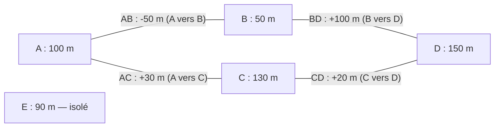

# Activité 10 — Recherche d'un trajet à dénivelé positif minimal

> Projet Java / théorie des graphes — état de développement testé avec Java 21.
> Ce document distingue le travail de l'étudiant, l'aide reçue et les fichiers écrits par ChatGPT.

## 1. Objectif

Modéliser un réseau routier sous forme de graphe et rechercher un trajet entre deux lieux qui minimise la somme des dénivelés positifs. Les descentes ont un coût nul : on ne cherche ni la distance géographique minimale, ni le dénivelé net, mais le cumul des montées.

Pour une route de poids signé `p` orienté de A vers B, le coût A → B est `max(0, p)` et le coût B → A est `max(0, -p)`. Le réseau de test utilise des poids égaux aux différences d'altitude. Le programme ne calcule pas automatiquement ces poids depuis `z` : ils sont fournis lors de la création de la route.

Les coûts utilisés par Dijkstra doivent être positifs ou nuls. Les routes sont parcourables dans les deux sens, avec des coûts potentiellement différents.

## 2. Organisation des classes et répartition du travail

| Fichier | Rôle | Contribution |
|---|---|---|
| `Lieu.java` | Altitude, routes incidentes et successeurs | Étudiant ; conseils de conception et de débogage de ChatGPT lors des échanges précédents |
| `Route.java` | Extrémités, poids signé, coût selon le sens du parcours | Étudiant |
| `tempDriska.java` | État temporaire d'un sommet, sélection du minimum, relaxation | Étudiant ; conseils d'optimisation de ChatGPT |
| `Trajet.java` | Initialisation, boucle de Dijkstra, reconstruction et dénivelé total | Étudiant ; conseils de débogage de ChatGPT |
| `ReseauRoutier.java` | Stockage et construction cohérente du graphe | Squelette de l'étudiant, complété par ChatGPT |
| `Main.java` | Construction d'un graphe de test et exécution des vérifications | Squelette initial de l'étudiant, remplacé par un banc de tests écrit par ChatGPT |
| `test.java` | Petite classe d'essai sans rôle dans l'algorithme | Étudiant ; inchangée |
| `README.md` | Documentation, répartition et résultats | ChatGPT, à partir des fichiers transmis et des échanges |

Les seuls fichiers livrés dans cette intervention sont `ReseauRoutier.java`, `Main.java` et `README.md`. Les cinq autres fichiers (`Lieu`, `Route`, `Trajet`, `tempDriska`, `test`) ont été copiés à l'identique dans un répertoire temporaire pour compiler et exécuter les tests. Leur identité avec les fichiers transmis a été vérifiée octet par octet. Aucune correction, même de syntaxe, n'a été apportée à ces classes.

## 3. Travail réalisé par l'étudiant

### 3.1. Modélisation objet

- `Lieu` représente un sommet. Il possède une altitude, une liste de routes et une liste de successeurs. Le constructeur initialise les deux listes à vide ; `ajouterRoute` associe ensuite une route et son extrémité opposée au lieu.
- `Route` représente une arête. `getOppose` retrouve l'autre extrémité ; `getPoidsRoute` donne le coût dans le sens de déplacement demandé, en ramenant les descentes à zéro.
- `tempDriska` sépare les informations propres à une recherche des données permanentes du réseau. Chaque instance contient un lieu, une distance provisoire, une marque et un parent. Cela évite d'ajouter les états de Dijkstra directement aux lieux.
- `Trajet` conserve les listes de lieux et de routes de la solution et le coût total.

### 3.2. Implémentation de Dijkstra

1. Création d'un objet `tempDriska` pour chaque lieu, avec une distance infinie (`Double.POSITIVE_INFINITY`), un parent nul et une marque à `false`.
2. Construction d'une `HashMap<Lieu, tempDriska>` qui associe chaque lieu à son état temporaire. Les mêmes instances sont aussi stockées dans un `ArrayList`.
3. Récupération du véritable sommet de départ via la map, marquage de celui-ci, distance initiale à zéro, puis relaxation de ses voisins.
4. Tant qu'il existe un sommet non marqué dont la distance est finie, sélection du sommet ayant la plus petite distance, marquage, puis mise à jour des distances de ses voisins.
5. Si un chemin améliore strictement une distance, modification de cette distance et du parent correspondant.
6. Remontée des parents depuis l'arrivée pour reconstruire les lieux et les routes du trajet. Enregistrement de la distance finale dans `deniveleTotal` lorsque le parent de l'arrivée existe.

L'initialisation du départ réalise manuellement la première itération habituelle de Dijkstra. Le `while` vérifie ensuite la condition avant toute nouvelle itération, ce qui traite correctement le cas d'un départ isolé.

### 3.3. Aide apportée lors des échanges précédents

ChatGPT a expliqué l'usage de `HashMap.put` et `get`, suggéré de remplacer une recherche linéaire par une map, signalé des erreurs d'initialisation et de reconstruction, expliqué la différence entre `while` et `do while` dans cette initialisation, et proposé de séparer création des lieux et association des routes. L'étudiant a intégré lui-même ces changements dans les versions successives. Il reste responsable de l'implémentation de l'algorithme et des corrections à venir.

## 4. Travail réalisé par ChatGPT dans cette intervention

### 4.1. `ReseauRoutier.java`

- Initialisation des deux listes dans le constructeur.
- `ajouterLieu(Lieu)` enregistre un lieu non nul et refuse de réinscrire la même instance.
- `ajouterRoute(Lieu A, Lieu B, int poids)` vérifie que les extrémités appartiennent au réseau, crée la route, l'enregistre dans le réseau et appelle `ajouterRoute` sur chacun des deux lieux.
- Retourne l'objet `Route` créé, afin de permettre notamment des comparaisons de références dans les tests.
- Choix de conception de ChatGPT : réseau simple, sans boucles ni routes parallèles. Ce choix est cohérent avec la reconstruction actuelle de l'étudiant, mais devra être revu si le cahier des charges impose un multigraphe.
- Refus de `Integer.MIN_VALUE` car son opposé ne peut pas être représenté par un `int` ; les autres poids signés sont acceptés. Le contrôle de cohérence du poids avec les altitudes n'est pas imposé par cette classe.
- Les getters d'origine sont conservés ; ils exposent les listes modifiables. La cohérence est garantie lors d'un usage normal des méthodes d'ajout, pas si le code appelant modifie directement ces listes ou les associations des lieux.

### 4.2. `Main.java`

Le `Main` est un banc de tests autonome, sans dépendance externe. Chaque vérification compare un résultat attendu à un résultat obtenu ; un échec ne bloque pas les tests suivants. Le programme termine avec un bilan et un code de sortie 1 si au moins un test échoue.

Le coût total et la liste `parents` n'ont pas de getter dans `Trajet`. Pour les vérifier sans modifier cette classe, le `Main` utilise exceptionnellement la réflexion Java (`getDeclaredField`, `setAccessible`, `get`) **en lecture uniquement**. Il n'écrit aucun champ et ne corrige pas l'algorithme pendant les tests. À remplacer par des getters lorsque l'étudiant les aura ajoutés.

Les tests sur le choix des routes sont indépendants de leur ordre. Un test distinct impose l'ordre départ → arrivée ; ainsi, le choix du bon itinéraire peut réussir même si sa restitution est à l'envers.

## 5. Graphe de test



| Route | Coût aller | Coût retour |
|---|---:|---:|
| A → B | 0 | 50 |
| B → D | 100 | 0 |
| A → C | 30 | 0 |
| C → D | 20 | 0 |

De A vers D, A → B → D coûte 100 m et A → C → D coûte 50 m. Dijkstra doit d'abord examiner B (distance 0), attribuer provisoirement 100 à D, puis examiner C (distance 30) et améliorer D à 50. Ce graphe teste réellement la relaxation d'un sommet déjà découvert.

| Après traitement de | A | B | C | D | E |
|---|---:|---:|---:|---:|---:|
| Initialisation | 0 | ∞ | ∞ | ∞ | ∞ |
| A | 0 | 0 | 30 | ∞ | ∞ |
| B | 0 | 0 | 30 | 100 | ∞ |
| C | 0 | 0 | 30 | 50 | ∞ |
| D | 0 | 0 | 30 | 50 | ∞ |

B est volontairement ajouté avant A dans le réseau pour tester l'initialisation du véritable sommet de départ indépendamment de son indice.

## 6. Résultats réellement obtenus

Compilation réussie avec OpenJDK 21.0.12.1, puis exécution de `Activite10.Main` sur les classes de la dernière version transmise. **8 tests réussis sur 13 ; 5 échecs.**

| Test | Résultat | Observation |
|---|---|---|
| Construction et associations | Réussi | 5 lieux, 4 routes, associations réciproques contrôlées |
| Coûts selon le sens | Réussi | Descente à 0, montée au dénivelé attendu |
| Route vers un lieu hors réseau | Réussi | Refus sans ajout au réseau |
| A → D, relaxation et coût | Réussi | Routes AC et CD, coût 50 |
| A → B, descente directe | Réussi | Route AB, coût 0 |
| D → A | Réussi | Routes CD et AC, coût 0 |
| E → A, départ isolé | Réussi | Aucune route, aucune exception |
| A → E, arrivée inaccessible | Réussi | Liste de routes vide, aucune exception |
| A → D, ordre des routes | Échec | La liste est reconstruite à l'envers |
| Getters départ et arrivée | Échec | Les attributs ne sont pas renseignés |
| A → A | Échec | Coût 0 et aucune route, mais la liste des lieux ne contient pas A |
| A → E, coût d'un trajet impossible | Échec | Valeur 0 au lieu de l'infini attendu par le test |
| Deux recherches sur un même `Trajet` | Échec | 3 routes au lieu d'une après la seconde recherche |

Le résultat attendu `+∞` pour un trajet inaccessible est une convention choisie pour les tests ; une autre représentation explicite de l'absence de chemin serait possible. Une liste vide seule ne distingue pas un trajet impossible d'un trajet valide de longueur nulle. Le résultat de ces tests ne prouve pas la correction sur tous les graphes.

## 7. Points à améliorer par l'étudiant

### Priorité 1 — Rendre le résultat correct et exploitable

- [ ] **Ordre du trajet (`Trajet`, reconstruction)** : les listes sont remplies depuis l'arrivée. Obtenir l'ordre départ → arrivée, par exemple en inversant les listes à la fin (`Collections.reverse`). Corriger également le commentaire qui indique « ajout de l'arrivée » alors que la dernière étape ajoute le départ.
- [ ] **Départ et arrivée (`Trajet`, constructeur et recherche)** : les attributs ne sont jamais assignés. Décider si le constructeur fixe les extrémités ou si chaque recherche les fixe, sans maintenir deux sources contradictoires.
- [ ] **Cas départ = arrivée** : un trajet valide de coût 0 contient le lieu de départ et aucune route. La condition actuelle fondée sur l'existence d'un parent ne le traite pas.
- [ ] **Destination inaccessible** : représenter explicitement l'échec de recherche, par exemple via `deniveleTotal = Double.POSITIVE_INFINITY`, un booléen ou un type de résultat adapté. Adapter le test si une autre convention est retenue.
- [ ] **Recherches successives** : réinitialiser les listes et le coût au début de chaque recherche, pour éviter d'accumuler les résultats précédents.
- [ ] **Accès au résultat** : prévoir des getters pour le coût et les lieux du trajet, afin de supprimer la réflexion du banc de tests. Vérifier aussi que départ et arrivée appartiennent bien au réseau avant de les récupérer dans la map.

### Priorité 2 — Améliorer les structures et la complexité

- [ ] Passer la `HashMap` à `miseAJourDistance` et remplacer `getDriskaDepuisLieu` par `map.get(oppose)`. Actuellement, chaque recherche d'état d'un voisin parcourt l'`ArrayList` : O(V), contre O(1) en moyenne pour un accès à la map.
- [ ] Envisager de parcourir `map.values()` pour éviter de maintenir une liste et une map contenant les mêmes objets. L'ordre de parcours d'une `HashMap` n'est pas garanti ; si plusieurs trajets ont le même coût, la solution choisie peut varier.
- [ ] Fusionner la sélection du premier sommet non marqué et la recherche du minimum. Éviter d'appeler `marquerSMin` lorsqu'aucun sommet éligible ne subsiste, ou sécuriser cette méthode.
- [ ] Ignorer explicitement les sommets déjà marqués lors de la relaxation. Pour des coûts non négatifs et une sélection correcte du minimum, ce n'est pas une erreur actuelle de les examiner : leur distance ne peut plus être strictement améliorée.
- [ ] Arrêter la recherche lorsque l'arrivée est marquée si seul ce trajet est demandé.
- [ ] Étudier `PriorityQueue` après validation de la version actuelle. Pour une implémentation par insertions multiples, gérer les anciennes entrées devenues obsolètes ; ne pas modifier en place une priorité déjà insérée sans rétablir l'ordre du tas.

**Complexité actuelle**, pour V sommets et E routes, dans le pire cas où tous les sommets sont accessibles : O(V² + VE) en temps pour la recherche (sélection linéaire des minima et recherche linéaire des états pour chaque arête), O(V) en mémoire auxiliaire hors graphe et hors résultat. Avec la map exploitée lors des relaxations : O(V² + E) en temps moyen, en conservant la sélection linéaire. Avec un tas et une gestion adaptée des entrées obsolètes, on peut atteindre O((V + E) log V) sur un graphe simple, en supposant les accès à la map en temps moyen constant. Ces estimations concernent la phase de recherche, pas la construction du réseau ni la reconstruction des routes.

### Priorité 3 — Qualité et extension du modèle

- [ ] Renommer progressivement `tempDriska` en `TempDijkstra` et `rechercheDrijska` en `rechercheDijkstra` ; respecter les conventions Java de nommage.
- [ ] Supprimer l'attribut `successeurs` inutilisé dans `tempDriska`. Dans `Lieu`, envisager de déduire les successeurs des routes plutôt que de stocker deux listes modifiables séparées.
- [ ] Simplifier le calcul du coût avec `Math.max` et protéger les appels de `getPoidsRoute` depuis un lieu qui n'est pas une extrémité (actuellement retour -1, qui serait incompatible avec Dijkstra s'il était utilisé comme coût).
- [ ] Clarifier si le poids doit être calculé à partir de `z` ou fourni séparément. Si le dénivelé est une différence d'altitude, contrôler aussi les dépassements de capacité sur des valeurs extrêmes.
- [ ] Si un multigraphe est nécessaire, mémoriser la **route exacte** ayant permis d'améliorer la distance, et non uniquement le parent. `getRouteDepuisSucc` retrouve la première route, pas nécessairement celle retenue par l'algorithme. Adapter le refus des routes parallèles dans `ReseauRoutier`.
- [ ] Protéger les listes internes contre les modifications incohérentes et centraliser la construction du réseau.
- [ ] Ajouter des tests sur plusieurs graphes, cycles, chemins de coûts égaux, coûts très grands et entrées invalides ; éventuellement migrer vers JUnit et ajouter une intégration continue GitHub.

## 8. Compilation et utilisation

Conserver les classes de l'étudiant et remplacer uniquement `ReseauRoutier.java` et `Main.java` par les fichiers livrés. Placer les fichiers dans un dossier nommé `Activite10`, correspondant à la déclaration `package Activite10;`. Placer ce README à la racine du projet (ou à côté des sources si préféré).

```text
projet/
├── README.md
└── Activite10/
    ├── Lieu.java
    ├── Route.java
    ├── ReseauRoutier.java
    ├── Trajet.java
    ├── tempDriska.java
    ├── Main.java
    └── test.java
```

Depuis le dossier `projet`, avec un JDK 21 ou supérieur (`ArrayList.getLast()` est utilisé par l'étudiant) :

```powershell
javac -encoding UTF-8 -d out Activite10/*.java
java -cp out Activite10.Main
```

Si le terminal Windows ne développe pas le motif `*.java`, utiliser PowerShell :

```powershell
$sources = (Get-ChildItem Activite10 -Filter *.java).FullName
javac -encoding UTF-8 -d out $sources
java -cp out Activite10.Main
```

Le code de sortie 1 est attendu dans la version actuelle, car cinq vérifications échouent. Après correction, l'objectif est d'obtenir 13 réussites et 0 échec (si les conventions des tests sont conservées). Le dossier `out` contient les classes compilées ; il n'est pas nécessaire de le versionner dans Git.

## 9. Bilan

L'étudiant a conçu et implémenté les parties principales du modèle et de Dijkstra, avec des conseils de ChatGPT. Les tests démontrent le bon choix des routes et le calcul des coûts sur le réseau d'exemple. Ils mettent également en évidence des limites de restitution et de réutilisation du résultat. La prochaine étape est de corriger ces limites sans réécrire le cœur de l'algorithme, puis de relancer les tests.
